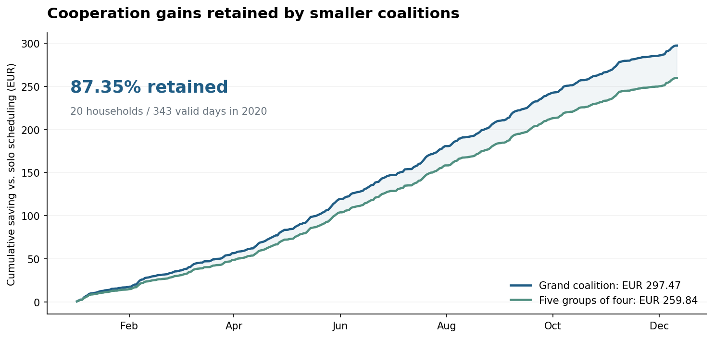

# Energy Management and Profit-Sharing Mechanisms for Prosumer Coalitions

Python framework accompanying my diploma thesis at the **National Technical University of Athens**, School of Electrical and Computer Engineering, July 2026.

**Author:** Kyriakos Katsiadramis · **Supervisor:** Prof. Dimitris Fotakis

[Read the thesis](docs/thesis.pdf) · [View the presentation](docs/thesis_presentation.pdf) · [Framework guide](docs/framework.md)

The project connects residential energy scheduling, cooperative profit allocation and coalition formation. It combines **mixed-integer optimization**, **k-medoids clustering** and **cooperative game theory** to study how smaller groups of prosumers and consumers can retain the economic benefit of coordinating an entire energy community.

## What the framework does

- Compares passive operation, individual battery scheduling, grand-coalition coordination and subcoalition operation using 15-minute consumption, PV and price profiles.
- Selects representative days with k-medoids and explicit import/surplus extremes, then estimates weighted pairwise cooperation scores.
- Forms equal-size groups with a two-stage lexicographic MILP or multistart local search.
- Allocates cooperation surplus using positive leave-one-out marginal contributions and compares the rule with exact Shapley values on a small subset.
- Tests accepted migrations by each group's weakest member and evaluates targeted demand response against an ideal central-battery benchmark.

All stages share one configuration, one output directory and cached coalition costs. The complete workflow runs through a single entry point.

## Selected thesis results

The recorded 20-household experiment covers **343 valid days of 2020**, with five subcoalitions of four participants.

| Operating mode | Cost over the evaluation horizon |
| --- | ---: |
| Passive baseline | €7,259.68 |
| Individual battery scheduling | €6,670.89 |
| Grand coalition | €6,373.42 |
| Selected subcoalitions | €6,411.05 |

The grand coalition saves **€886.26**, or **12.21%**, relative to the passive baseline. The selected groups retain **87.35% of the additional coordination gain** beyond individual scheduling. The thesis also evaluates 30- and 50-player communities, an 8-player Shapley benchmark, migration stability and demand response.



These figures come from the original thesis experiment. The recorded daily costs and partition are available in [reference_results](docs/reference_results), alongside the full methodology in the thesis PDF.

## Run the complete demo

Use Python 3.10 or newer. From the repository directory:

```bash
python -m venv .venv
# Linux/macOS
source .venv/bin/activate
# Windows PowerShell: .venv\Scripts\Activate.ps1
python -m pip install -e ".[test]"
python run_framework.py --config configs/demo.json
```

The demo generates its own synthetic profiles and runs every stage, including Shapley, migration stability and demand response. It writes CSV results, plots and a readable `report.md` to `outputs/demo/`. Demo results describe the generated profiles.

The installed command is also available:

```bash
energy-community --config configs/demo.json
```

## Use the thesis data

Set `data_dir` in a configuration to your prepared CSV folder, or place the folder at `data/private/processed_data_clean/`. Paths in configurations are relative to the configuration file. Household energy is in kWh per 15-minute interval; prices are in EUR/kWh. The [framework guide](docs/framework.md) specifies the CSV columns and experiment settings.

```bash
python run_framework.py --config configs/thesis_20.json
```

| Configuration | Experiment |
| --- | --- |
| `demo.json` | Six synthetic participants, six days, groups of two |
| `thesis_20.json` | 20 measured profiles, groups of four, complete thesis workflow |
| `thesis_20_recorded_partition.json` | The original recorded 20-player partition |
| `thesis_30.json` | 30 participants, groups of six, MILP formation |
| `thesis_50_size10.json` | 50 participants, 25 prosumers/25 consumers, local search, groups of ten |
| `thesis_50_size5.json` | The same 50-player population, groups of five |

The larger populations combine measured and synthetic household profiles as described in the thesis. Prepared research data is supplied through the configuration; synthetic demo data is generated automatically.

Run a specific stage together with its dependencies:

```bash
python run_framework.py --config configs/thesis_20_recorded_partition.json --stage evaluate
python run_framework.py --config configs/demo.json --stage demand_response
```

Repeating a command resumes completed stages and coalition solves for identical inputs and settings. For another experiment, choose a separate directory with `--output`. Full research runs perform many optimization solves; checkpoints preserve progress.

## Repository guide

| Location | Contents |
| --- | --- |
| `src/energy_community/` | Data preparation, shared optimizer, clustering, grouping, allocation, stability, demand response and reporting |
| `configs/` | Reusable experiment settings |
| `docs/thesis.pdf` | Complete diploma thesis |
| `docs/thesis_presentation.pdf` | Thesis presentation |
| `docs/reference_results/` | Original recorded 20-player results and partition |
| `docs/demo_results/` | Results of a complete synthetic demonstration |
| `docs/validation/` | Numerical verification against recorded results |
| `tests/` | Physical, economic and end-to-end checks |

## Verification

```bash
python -m pytest -q
```

Tests check energy balance, cyclic battery state, budget-balanced allocation, Shapley efficiency, grouping objectives, energy-conserving demand response and safe resumption after interruption. GitHub Actions runs the public suite on Python 3.11 and 3.12.

The refactored optimizer was also checked against recorded 20-player costs on three actual dates, and the passive baseline was recomputed across all 343 valid days. Details and numerical comparisons are in [validation](docs/validation/README.md).

**Technologies:** Python, NumPy, pandas, Matplotlib, Google OR-Tools, SCIP, GLOP.
