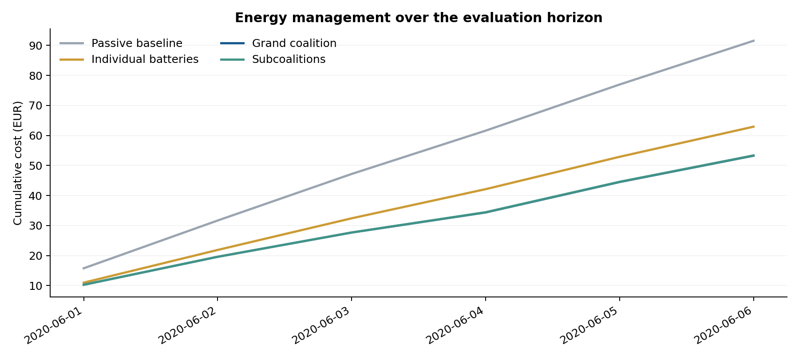
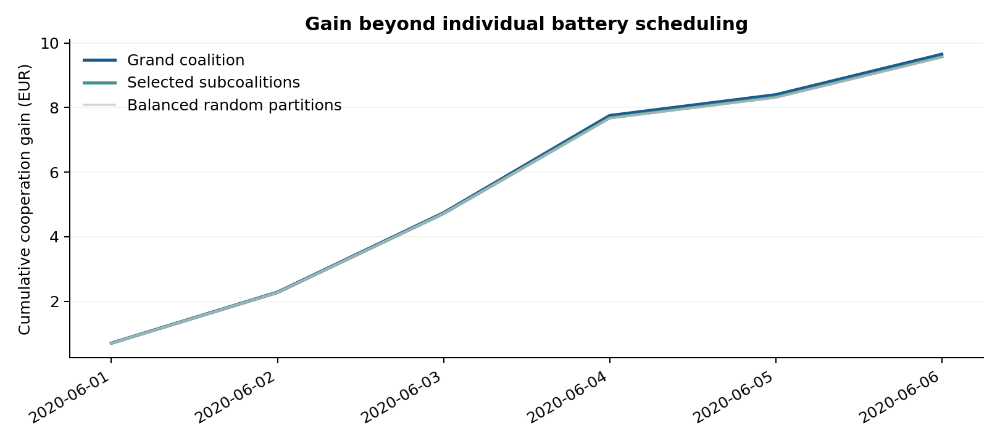
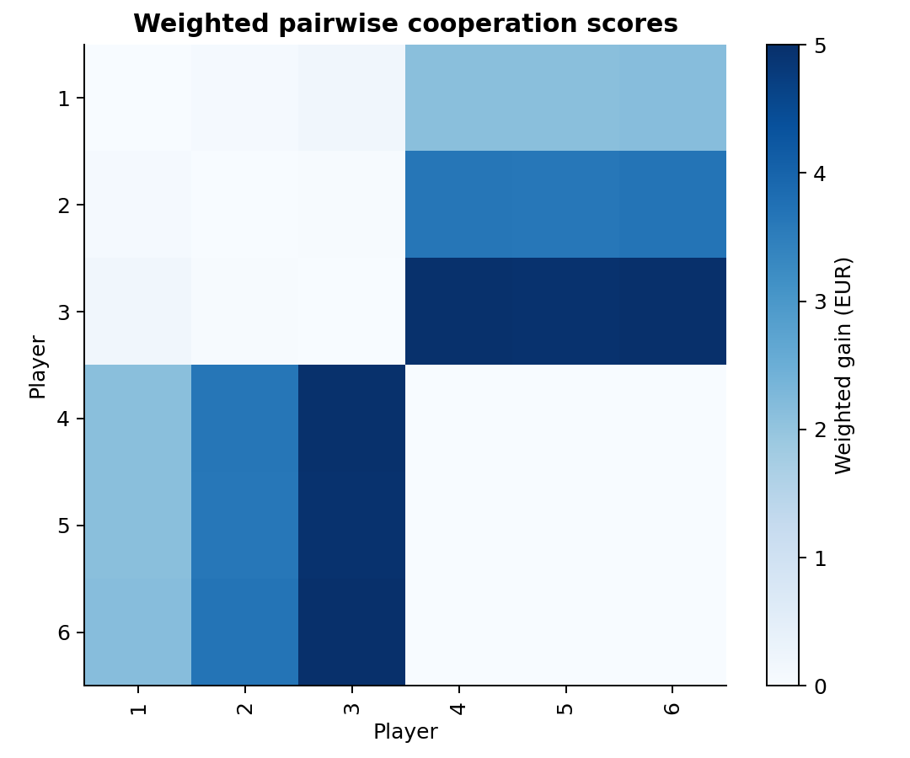
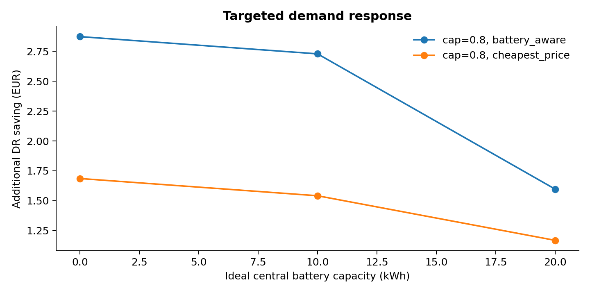

# Synthetic demonstration

Data: synthetic demonstration.
Participants: 6. Common evaluation days: 6.

| Operating mode | Total cost (EUR) |
| --- | ---: |
| Passive baseline | 91.526649 |
| Individual scheduling | 62.923077 |
| Grand coalition | 53.272220 |
| Selected subcoalitions | 53.349987 |

Selected groups recover 99.19% of the grand coalition coordination gain.

Accepted profitable migrations: 0 / 6, under the weakest-player migration criterion.

The DR experiment uses the ideal central-battery benchmark defined in the thesis, with perfect efficiency and no power or degradation limits.

Configuration, software versions and input SHA-256 hashes are recorded in `manifest.json`.
